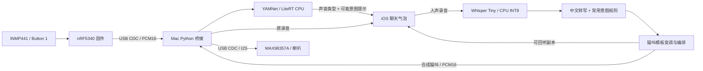

# 本机轻量猫语原型：架构与实现

此版本在 Mac 本机增加声音类型识别、中文语音转写和猫叫合成。沿用 nRF5340 的按键录音、USB 桥接、iOS 模拟器聊天窗口、原音回听及本地历史。

## 能力边界

YAMNet 识别“猫、喵叫、呼噜、嘶叫、长嚎”等声音事件，并不识别猫的语言。界面中的“可能在呼唤/寻求关注”等文字是公开可审查的产品规则提示，未经个体猫行为标注验证。对人声、静音、低分或过短输入显示无法确认，不编造具体含义；分类器仍可能误判。

人声方向使用 Whisper Tiny 转写中文，再以关键词规则映射为打招呼、呼唤、吃饭邀请、安抚、玩耍邀请、轻声提醒、普通互动。猫叫由样例音频变调和编排生成；不是逐字猫语翻译，也没有证据表明猫能理解原句。当前是可运行的交互原型，未测量真实场景识别准确率。

## 架构



计算全部放在 Mac；nRF5340 不运行神经网络，无需改接线或重烧固件。App 通过原 WebSocket 接口收发，模型在桥接启动时加载；不会通过网络下载模型或发送录音。模型与模板安装总大小约 **94.5 MB（90.1 MiB）**。首次安装依赖及模型需要联网。

- 猫叫方向：20 ms 帧分段收集，松开 Button 1 立即保留原录音气泡，后台返回同一消息 ID 的文字结果。YAMNet 输入为 16 kHz / 0.975 秒窗口，约 50% 重叠；最多 4 个设备识别任务等待执行，模型锁使推理串行，避免阻塞 USB 线程和网络事件循环。
- 人声方向：App 结束录音后，Whisper Tiny CPU INT8 + VAD 转写，规则映射为意图，合成猫叫并按 20 ms 帧节奏播放到开发板。识别失败不会改为外放原人声，而是显示错误并释放播放占用。原音仍可本地回听。
- 猫叫合成：默认使用 TensorFlow YAMNet 教程的 `miaow_16k.wav` 第一段叫声，按意图调整音高和次数，峰值限制在 0.55。没有模板时使用谐波/共振峰声音设计回退；安装脚本会安装并校验模板。合成不是生成式语言模型。
- 静音、过短或信号太弱会拒识，YAMNet 类别分数不作为“语义翻译正确率”。当前类别阈值为试验值，尚未基于设备实采猫叫集校准。
- 原声、文字、合成猫叫均保存在 App 本地；历史索引新增可选字段，兼容既有聊天记录。云同步、真机无线连接、语义对话模型尚未增加。

## 安装和运行

本机已完成安装，且已启动新版服务。新环境建议使用 Python 3.12。

```bash
python3.12 -m venv .venv
bash scripts/setup-local-ai.sh
bash scripts/run-chat.sh
# 另一个终端启动 App
bash scripts/run-ios.sh
```

若 Hugging Face 官方源在当前网络不可达，可用 `bash scripts/setup-local-ai.sh --mirror`。这只将公开权重下载改为 hf-mirror.com，仍校验相同 SHA-256，不发送录音。本机本次下载 Whisper 使用了该镜像。

`bridge/model-manifest.json` 保存文件来源、固定 Whisper 版本、大小和 SHA-256；`models/` 已被 Git 忽略。启动时只读取本地文件，缺少模型直接报错。依赖固定在 `bridge/requirements-ai.txt`。

需要显式恢复原始语音透传时，先结束当前桥接，再运行：

```bash
bash scripts/run-chat.sh --no-ai
```

## 使用

1. 开发板：按住 Button 1 录一段真实猫叫，松开后出现左侧原声气泡；识别结束在其下方显示声音类型相关文字。点击原气泡仍播放原录音。
2. App：点击说话，录“你好，过来吃饭”，再次点击结束发送。右侧显示原音气泡、转写文字及意图，开发板播放生成的猫叫；“回听合成猫叫”在 Mac 上播放相同猫叫副本。
3. 单条录音仍最长 60 秒，支持取消，聊天历史及语音重启保留。旧消息不会自动重新识别。
4. 可在右上角设置查看本地模型就绪状态。两端录音/播放仍采用半双工，防止回声。

## 验证

```bash
.venv/bin/python -m unittest discover -s bridge -v
.venv/bin/python scripts/smoke-local-ai.py models/yamnet/miaow_16k.wav artifacts/mandarin-fixture.aiff
```

第二条命令需要本机测试音频；本轮通过 `say -v Tingting` 生成“你好，过来吃饭”的 AIFF 测试输入。真实模型测试中，6.73 秒猫叫样例被识别为“喵叫”；中文输入转写为“您好，过来吃饭”，映射为吃饭邀请，生成约 2.92 秒猫叫。一次本机测量：模型加载约 364 ms、猫叫分类约 37 ms、转写及合成约 521 ms；该时间为样例实测，并非性能保证，也非语义准确率评估。

15 项协议及逻辑回归测试通过；真实模型负样例检查中，静音返回“声音过轻”、白噪声返回“未确定”，静音人声不生成猫叫。协议及逻辑回归覆盖原有收发、消息关联、积压上限、PCM 边界、常用意图、否定优先、猫叫幅度、识别失败不播放原人声以及旧流式接口不能绕过识别。App 编译与模型实测日志位于 `artifacts/ios-local-ai-build.log`、`local-ai-model-smoke.json`。

现场链路已在 App 中看到设备猫叫上传后的文字结果，以及人声转写、猫叫回听按钮和开发板播放完成状态；重启 App 后新旧消息、文字与猫叫副本仍保留。实际声学听感由现场使用者核对。

## 来源与后续

- [YAMNet 官方模型与说明](https://github.com/tensorflow/models/tree/master/research/audioset/yamnet)：521 类声音事件分类，MobileNet 架构。
- [TensorFlow 官方教程及猫叫样例](https://www.tensorflow.org/hub/tutorials/yamnet)：本原型音频模板来源。模板未纳入 Git。
- [faster-whisper](https://github.com/SYSTRAN/faster-whisper) 与 [Tiny 权重](https://huggingface.co/Systran/faster-whisper-tiny)：本地 CPU INT8 转写。

要提高“意图”识别质量，下一阶段需要采集同一只猫的音频、喂食/互动等上下文与人工行为标签，进行独立训练和留出评估；当前代码未用猜测标签冒充训练数据。
