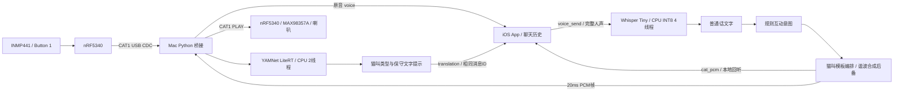

# 本机轻量级猫语识别与互动音架构

本版本在 Mac Python 桥接中完成离线推理，沿用现有 nRF5340 固件、接线、USB CDC 协议、16 kHz/单声道/PCM16 音频格式，以及 App 的录音、原音回听和历史保存。

## 能力与边界

设备上传猫叫后显示声音类型及保守的含义提示。App 上传普通话语音后显示转写及互动意图，生成猫叫并发往开发板喇叭；App 另外提供“回听合成猫叫”，原始人声气泡仍保留。

YAMNet 是声音事件分类器，不是猫与人类语言的语义翻译模型。喵叫、呼噜、嘶叫、长嚎的含义提示是人工规则，不能断言“猫饿了”等具体需求。人声到猫叫使用规则和音频模板编排，不是经过验证的猫语言编码，不保证猫理解原句。当前是可运行的本地互动原型。

## 数据流



| 模块 | 实现 | 用途 |
|---|---|---|
| 声音分类 | YAMNet TFLite，521 类，约 15.3 MiB | 猫叫、喵叫、呼噜、嘶叫、长嚎、人声和不确定 |
| 人声转写 | faster-whisper Tiny，多语言模型，CPU INT8 | 当前固定普通话；静音检测及低质量片段过滤 |
| 意图规则 | 打招呼、呼唤、吃饭、安抚、玩耍、轻声提醒、普通互动 | 按词匹配，否定词优先；复杂句可能误判 |
| 猫叫输出 | 本地猫叫模板裁剪、变速、淡入淡出、节奏组合 | 峰值约 0.55；模板缺失时使用谐波合成 |
| 传输与存储 | 原 WebSocket / CAT1 / App Documents | 原音、识别文字、生成猫叫分别保存 |

模型及模板合计约 90 MiB，不包含 Python 运行库；INT8 是推理配置，下载权重本身约 72 MiB。不需要 GPU、云端 API 或密钥。首次安装需要下载依赖和模型；推理只使用本地文件，不自动下载。

## 协议及状态

- 原 `voice` 消息增加可选 `translation_state: pending`，先显示可回放原音。
- 后续 `translation` 使用同一 UUID，携带 `state: ready|failed`、`text`、`note`、`result`；App 发送方向另带 `cat_pcm`（Base64 PCM）。
- App 发送状态为 `sending → translating → playing → played`；识别失败为 `failed`，不会将人声作为猫叫播放。
- `status` 增加 `ai_enabled`、`ai_ready` 及 `ai` 诊断信息。启动先验证模型，失败会输出安装指引；显式 `--no-ai` 可恢复原始透传模式。
- 设备识别任务最多保留 4 条，超出返回繁忙提示；推理由锁串行保护，在工作线程中运行，避免阻塞串口收包和 WebSocket 心跳。
- App 到设备的转换期间保留播放所有权，拒绝重复发送及设备录音；发送者断开时取消播放并静音。已开始的模型线程会完成当前计算，但不会继续发送音频。
- 原有 0.1–60 秒录音限制保留；短于 0.4 秒、静音或低置信音频显示无法判断。分类 score 只是模型分数，未经现场标定，不能解释成准确率。
- App 原 WAV 和历史 JSON 保留；新字段可选，兼容旧记录。生成音保存为 `<UUID>-cat.wav`，不覆盖原音。断线/重启把未完成识别标记中断。仍不提供离线消息补发或多端同步。

## 安装与启动

在项目根目录执行：

```bash
bash scripts/setup-local-ai.sh    # 首次安装；已有依赖和模型时可跳过
bash scripts/run-chat.sh          # 默认启用本地 AI，ws://127.0.0.1:8765
bash scripts/run-ios.sh           # 构建、安装并启动原模拟器 App
```

新机器先用 `python3.12 -m venv .venv` 建立环境，再执行安装脚本；当前机器已完成依赖、模型校验和模型加载。

无需重新刷固件。接线与 Button 1 操作不变。App 录音结束后等待本地转写和设备播放完成；点击原气泡听原音，点击“回听合成猫叫”听转换音。

模型目录 `models/`、虚拟环境和生成音频均忽略入 Git。`bridge/model-manifest.json` 记录下载来源、大小与 SHA-256，下载时校验后安装。复现原始透传：`bash scripts/run-chat.sh --no-ai`。

## 验证

```bash
.venv/bin/python -m unittest discover -s bridge -v
# 真实模型验证；CAT.wav 为猫叫样本，HUMAN.aiff 为含“吃饭”的普通话样本
.venv/bin/python scripts/smoke-local-ai.py CAT.wav HUMAN.aiff
```

2026-10-27：原协议及分段测试与新增 AI 测试共 15 项通过，包括完整消息关联、队列上限、真实 WebSocket 转换流程、只播放生成 PCM、ASR 失败不播放人声、阻止旧流式接口绕过转换。iOS 模拟器构建成功。

真实模型在本机识别 TensorFlow 教程猫叫样本为“喵叫”；本机合成普通话“你好，小猫，过来吃饭”转写为“您好,小猫,过来吃饭。”，映射“吃饭邀请”并生成约 2.9 秒猫叫。单样本测得猫叫分类约 31 ms、人声转换约 483 ms，不代表总体准确率或稳定延迟。日志见 `artifacts/local-ai-tests.log`、`local-ai-smoke.json`、`ios-local-ai-build.log`。现场麦克风猫叫、生成音听感和喇叭实际出声仍需现场验收。

## 来源与音频素材

- [YAMNet 官方教程](https://www.tensorflow.org/hub/tutorials/yamnet)：521 类事件分类、16 kHz 单声道输入，以及示例猫叫 `miaow_16k.wav`。本地模板取此示例 0.70–2.05 秒，做变速、音量调整和编排，用于当前本地原型。教程页面标注内容 CC BY 4.0、代码 Apache 2.0；音频素材对外分发时需核实其具体授权。
- [YAMNet 官方实现及模型](https://github.com/tensorflow/models/tree/master/research/audioset/yamnet)。
- [faster-whisper 官方实现](https://github.com/SYSTRAN/faster-whisper)：CPU INT8 和本地模型加载。
- [Whisper Tiny 转换权重](https://huggingface.co/Systran/faster-whisper-tiny)，具体文件版本见模型清单。

后续如需识别具体情境，应采集本猫的声音、行为与现场标签并进行独立评估，再考虑训练轻量分类头；当前版本不宣称已完成这种训练。

## 后台标注与合成音重复发送（2026-10-27）

- 新增标准库 `ThreadingHTTPServer` 标注后台，默认 `http://127.0.0.1:8766`；SQLite WAL 保存完整 PCM、上传时间、模型提示、人工标签、情境备注和标注时间。归档在工作线程执行，分类结果稍后更新；更新模型提示不会覆盖人工标注。不连接 App 或关闭 AI 时也可归档。
- 后台提供录音列表、分页、只看未标注、WAV 回听和编辑保存。HTTP 仅绑定 loopback，检查 Host、JSON Content-Type 和写请求 Origin。`data/` 忽略入 Git。人工标签会参与后续录音的相似匹配（详见后续章节），不修改基础模型权重。
- 新增 `cat_send` WebSocket 命令：App 从已保存的 `<UUID>-cat.wav` 读取 PCM，用新的发送请求 UUID 上传，直接复用原有节奏播放，不经过 Whisper 或猫叫生成器。`delivery` 返回相同请求 UUID 的 `playing → played|failed`，App 将它关联到原消息，并独立保存成功重发次数。
- 每次点击重发一遍，播放完成后可以继续点击；设备繁忙时拒绝，失败或断线后可重试。重发不新增重复聊天气泡，不覆盖原始录音、转写或合成猫叫。
- `scripts/import-cat-history.py` 可将旧 App 历史中的设备 WAV 按 UUID 导入后台；已归档样本及人工标注不被重复导入覆盖。
- 补充验证：HTTP 保存/回听/来源限制、标签持久化与后续模型结果独立更新、分页、无 App/无 AI 时归档、同一 PCM 连续重发三次且不调用模型、无效音频与设备忙失败、完成回执后不误静音下一次播放。验证日志：`artifacts/annotation-replay-tests.log`；App 构建：`artifacts/ios-annotation-replay-build.log`。

## 删除与人工样本识别

`recordings` 表追加 `deleted_at`、`feature`、`feature_version` 三个可空字段，启动时自动迁移旧数据库，保留既有录音和标注。删除仅标记时间并退出正常列表及识别样本库；回收站允许恢复。`POST /api/delete/<UUID>`、`POST /api/restore/<UUID>` 共用原标注写请求的本机来源检查；列表支持 `deleted=1`。

新增 `bridge/sound_examples.py`：使用纯 NumPy 提取 16 kHz PCM 的 32 频带对数 Mel 谱，去除低能量两端后汇聚为 24 个时间位置，并附频带均值和标准差，得到归一化的 832 维声学特征。特征按版本惰性缓存到 SQLite，人工标签和删除状态在每次识别时重新读取，无需重训或重启。

设备上传流程为：原音归档 → YAMNet 分类 → 有效人工样本匹配 → 保存识别结果 → WebSocket 返回 App。仅非静音、至少 0.4 秒且原模型未判为主要人声的录音参与。排除当前上传本身，以余弦相似度至少 0.94、与最高不同标签样本至少相差 0.04 为采用门槛。标注冲突或不够接近则沿用 YAMNet 提示。阈值为保守工程初值，未经真实猫群数据标定，不代表准确率。

匹配结果含 `recognition_source: annotated_example`、`example_id`、`similarity` 和 `model_prediction`；App 通过原有文字消息展示人工标签及来源说明，网页同时显示原模型提示。这是示例检索识别，不是猫语语义翻译模型训练。仅影响新上传；既有聊天文字不回溯修改。

验证覆盖旧库迁移、标注更改即时生效、删除/恢复/重启后样本资格、标签冲突拒绝、噪声/静音/人声拒绝、自身样本排除、HTTP 删除和来源限制，以及完整桥接上传后返回人工标签。真实 YAMNet 教程猫叫也已在临时数据库验证标注匹配、删除停用、恢复启用。日志：`artifacts/delete-recognition-tests.log`、`artifacts/example-real-model-smoke.json`。

## 再播放后重新录制的匹配修复

固定 24 段特征对录音起止和静音变化敏感，现场同一猫叫再次录入可能低于 0.94 的全局门槛。本轮增加活动帧检测、通道均值归一化和子序列动态时间对齐（DTW）。特征缓存版本升级为 `mel32-cmvn-sequence-v2`，旧缓存自动重新提取。

全局匹配仍要求相似度至少 0.94、不同标签差值至少 0.04；时间对齐匹配独立要求至少 0.90、不同标签差值至少 0.02，并要求覆盖至少 45% 的较长活动序列及至少 50% 的较短活动序列。两种匹配给出冲突标签时不采用。对齐序列最多 240 帧，保持本机轻量运行。阈值仅为工程初值，不代表准确率。

新增匹配诊断信息，区分采用人工标签、相似不足/标签冲突、匹配异常；异常不再静默隐藏。成功时 App 直接显示“猫叫识别：<标签>”，并附人工样本来源说明。

原有四条实际重新录制的“一起玩耍”样本分别排除自身后均可匹配；新增裁剪、前后静音和增益变化的回归测试。30 项测试通过。用户再次从终端实录上传的未标注新录音 `c452b6b5-2680-4ca9-8fe6-1726d971b2d5` 已命中旧样本 `1a3d1b84-6ea3-4ad7-9be0-62c8344aadaf`，App 实际显示“猫叫识别：一起玩耍”。该条全局相似度约 0.754，时间对齐相似度约 0.905。日志见 `artifacts/replay-recognition-tests.log`、`replay-recognition-regression.json`、`replay-recognition-live.json`。这证明本次复现链路已修复，不代表任意猫叫都能可靠识别含义。

## 常用互动与聊天滚动

App 固定展示八个互动词，通过 `phrase_send` 发送 `phrase_id` 和消息 UUID。桥接使用白名单将词语映射到已有合成意图，直接调用本机猫叫生成器，无需 Whisper 转写。生成和播放共用设备占用锁，返回 `generating → playing → played|failed`，以及包含文字和合成 PCM 的 `translation` 消息。断线、失败或取消后释放占用。

App 将生成音频按原有 WAV 历史格式落盘，消息新增可选 `phraseID`，兼容旧历史。后续重发沿用 `cat_send` 和独立请求 UUID；不重复生成，也不增加重复聊天气泡。新增测试覆盖八个词语、生成音频范围、生成一次后重复发送、非法词语、设备忙和 AI 未就绪。

聊天使用 SwiftUI `ScrollPosition` 支持手势和按钮按可视区域逐段上下滚动；通过滚动位置判断是否跟随最新消息，查看历史时保留位置。“最新”和主动发送恢复跟随。常用互动区固定在聊天列表下方，滚动历史时仍可操作。
